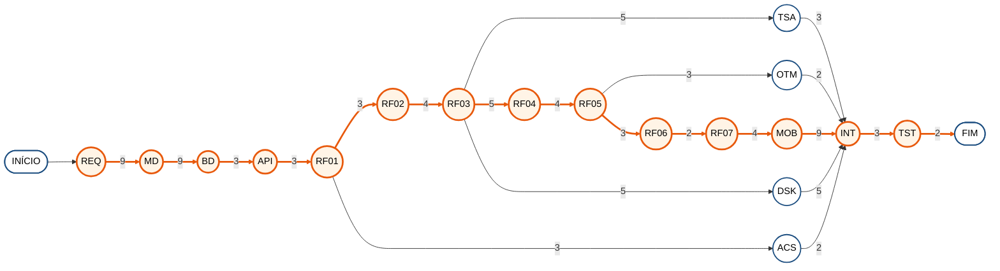
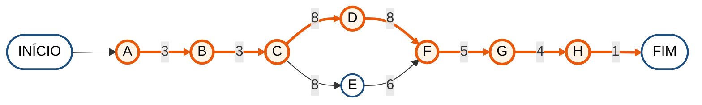
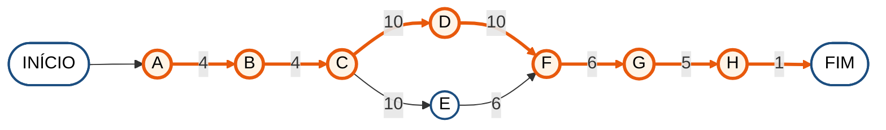
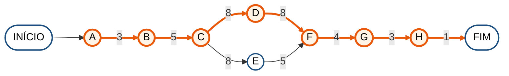
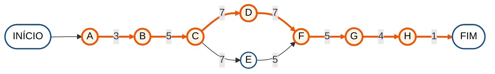

# Diagrama de Rede (CPM) — Avalia+ (PIM IV)

Este documento apresenta o **diagrama de rede** do projeto Avalia+ pelo Método do Caminho Crítico (CPM). Para cada atividade são indicados a predecessora, a duração, as datas de início e de término mais cedo e mais tarde e a folga. As atividades com folga zero formam o **caminho crítico**, destacado em laranja nos diagramas.

O documento traz duas visões:

1. **Rede geral do projeto:** cada atividade corresponde a um requisito funcional (RF01 a RF07) ou a uma atividade de base — requisitos, modelagem, banco de dados, API, aplicações desktop e mobile, integração e testes. A duração está em **dias úteis**, de 18/08 a 20/11 de 2026.
2. **Rede de cada requisito:** as atividades necessárias para implementar o requisito em todas as camadas — banco, API, aplicação web, aplicação desktop ou mobile, validação das regras e testes. A duração está em **horas de trabalho**.

> **Sobre as durações.** O projeto não registrou horas trabalhadas por requisito. As durações são **estimativas**, distribuídas de forma coerente com o cronograma real das sete sprints, cada uma com nove dias úteis de trabalho. Em cada requisito, o caminho crítico em horas corresponde à duração dele na rede geral, considerando um dia útil igual a oito horas de trabalho.

**Rede e sprints.** As sprints organizaram o trabalho por camada — requisitos, modelagem, banco, API, funcionalidades, aplicações e testes. A rede organiza o mesmo trabalho por dependência entre atividades. Por isso o período previsto de uma atividade na rede pode atravessar mais de uma sprint.

**Como ler os diagramas.** Cada círculo é uma atividade. O número sobre cada seta é a duração da atividade de onde a seta parte. As atividades e setas em laranja estão no caminho crítico.

**Legenda das colunas.** *Início cedo* e *Término cedo* são o primeiro momento em que a atividade pode começar e terminar; *Início tarde* e *Término tarde* são o último momento possível sem atrasar o projeto; *Folga* é a diferença entre o início tarde e o início cedo, ou seja, quanto a atividade pode atrasar sem mover a data final.

---

## Sumário

- [1. Rede geral do projeto](#1-rede-geral-do-projeto)
- [2. RF01 — Autenticar e controlar o acesso por perfil](#rf01--autenticar-e-controlar-o-acesso-por-perfil)
- [3. RF02 — Gerir os cadastros institucionais](#rf02--gerir-os-cadastros-institucionais)
- [4. RF03 — Gerir o banco de questões](#rf03--gerir-o-banco-de-questões)
- [5. RF04 — Gerar e realizar simulados](#rf04--gerar-e-realizar-simulados)
- [6. RF05 — Corrigir automaticamente e revisar as questões](#rf05--corrigir-automaticamente-e-revisar-as-questões)
- [7. RF06 — Acompanhar o desempenho](#rf06--acompanhar-o-desempenho)
- [8. RF07 — Atribuir pontuação e medalhas](#rf07--atribuir-pontuação-e-medalhas)
- [9. Resumo dos caminhos críticos](#9-resumo-dos-caminhos-críticos)

---

## 1. Rede geral do projeto

**Caminho crítico = 63 dias úteis** (18/08 a 20/11 de 2026)

| Atividade | Descrição | Predecessora | Duração (dias) | Início cedo | Término cedo | Início tarde | Término tarde | Folga | Período previsto |
| :---: | :--- | :---: | :---: | :---: | :---: | :---: | :---: | :---: | :---: |
| **REQ** | Consolidação dos requisitos e das regras de negócio v2.2 (REQ01 a REQ08) | — | 9 | 0 | 9 | 0 | 9 | **0** | 18/08 a 28/08 |
| **MD** | Modelagem do banco e ajuste dos diagramas UML (MD01 a MD10) | REQ | 9 | 9 | 18 | 9 | 18 | **0** | 01/09 a 11/09 |
| **BD** | Banco físico: script DDL, restrições e carga inicial (INF02 a INF04) | MD | 3 | 18 | 21 | 18 | 21 | **0** | 15/09 a 17/09 |
| **API** | Estrutura da API em camadas e endpoints REST (INF08, INF09) | BD | 3 | 21 | 24 | 21 | 24 | **0** | 18/09 a 22/09 |
| **RF01** | Autenticação e controle de acesso por perfil (PB01, INF10, INF11) | API | 3 | 24 | 27 | 24 | 27 | **0** | 23/09 a 25/09 |
| **RF02** | Gestão de cadastros institucionais (PB02) | RF01 | 4 | 27 | 31 | 27 | 31 | **0** | 29/09 a 02/10 |
| **RF03** | Gestão do banco de questões (PB03, INF12) | RF02 | 5 | 31 | 36 | 31 | 36 | **0** | 05/10 a 09/10 |
| TSA | Testes de API, permissões e desativação em cascata (TST01 a TST04) | RF03 | 3 | 36 | 39 | 55 | 58 | 19 | 13/10 a 15/10 |
| **RF04** | Geração e realização de simulados (PB04) | RF03 | 4 | 36 | 40 | 36 | 40 | **0** | 13/10 a 16/10 |
| DSK | Aplicação desktop do Administrador (PB09) | RF03 | 5 | 36 | 41 | 53 | 58 | 17 | 13/10 a 19/10 |
| **RF05** | Correção automática e revisão comentada (PB05, INF13) | RF04 | 3 | 40 | 43 | 40 | 43 | **0** | 19/10 a 21/10 |
| OTM | Procedures, triggers e índices do banco (INF05 a INF07) | RF05 | 2 | 43 | 45 | 56 | 58 | 13 | 22/10 a 23/10 |
| **RF06** | Acompanhamento de desempenho (PB06) | RF05 | 2 | 43 | 45 | 43 | 45 | **0** | 22/10 a 23/10 |
| **RF07** | Gamificação por pontuação e medalhas (PB07) | RF06 | 4 | 45 | 49 | 45 | 49 | **0** | 27/10 a 30/10 |
| ACS | VLibras e recursos de acessibilidade (PB08) | RF01 | 2 | 27 | 29 | 56 | 58 | 29 | 29/09 a 30/09 |
| **MOB** | Aplicativo mobile do Aluno (PB10) | RF07 | 9 | 49 | 58 | 49 | 58 | **0** | 02/11 a 13/11 |
| **INT** | Integração entre as três aplicações e a API (INF14) | MOB, DSK, ACS, OTM, TSA | 3 | 58 | 61 | 58 | 61 | **0** | 16/11 a 18/11 |
| **TST** | Testes de integração e registro das evidências (TST09 a TST11) | INT | 2 | 61 | 63 | 61 | 63 | **0** | 19/11 a 20/11 |

**Caminho crítico:** REQ → MD → BD → API → RF01 → RF02 → RF03 → RF04 → RF05 → RF06 → RF07 → MOB → INT → TST = 9 + 9 + 3 + 3 + 3 + 4 + 5 + 4 + 3 + 2 + 4 + 9 + 3 + 2 = **63 dias úteis**.

**Leitura.** A consolidação dos requisitos e a modelagem do banco abrem o caminho crítico porque todas as demais atividades dependem delas: uma alteração de requisito nessa fase propaga-se para o banco, para os diagramas e para as três aplicações. Depois da autenticação (RF01), o projeto mantém uma cadeia principal — cadastros, banco de questões, simulados, correção, desempenho e gamificação — porque cada funcionalidade consome os dados produzidos pela anterior. O aplicativo mobile entra no caminho crítico por ser a última aplicação a ser construída e por depender da gamificação, e a integração entre as três aplicações só pode começar quando a última delas estiver pronta.

As atividades fora do caminho crítico têm folga e poderiam atrasar sem mover a data final: TSA (19 dias), DSK (17 dias), OTM (13 dias), ACS (29 dias). A aplicação desktop é o exemplo mais relevante, pois foi essa folga que permitiu antecipá-la sem risco para o restante do cronograma.

---

## RF01 — Autenticar e controlar o acesso por perfil

Login por e-mail e senha, senha inicial pelo CPF, token de sessão e recuperação de senha por e-mail.

**Caminho crítico = 24 horas** (3 dias de trabalho)

| Atividade | Descrição | Predecessora | Duração (h) | Início cedo | Término cedo | Início tarde | Término tarde | Folga |
| :---: | :--- | :---: | :---: | :---: | :---: | :---: | :---: | :---: |
| **A** | Ajuste das tabelas Usuario e Perfil e das restrições de unicidade | — | 2 | 0 | 2 | 0 | 2 | **0** |
| **B** | Consultas de autenticação e armazenamento do hash da senha | A | 2 | 2 | 4 | 2 | 4 | **0** |
| **C** | Endpoints de login, primeiro acesso e recuperação de senha | B | 6 | 4 | 10 | 4 | 10 | **0** |
| **D** | Telas de login e de nova senha na aplicação web | C | 6 | 10 | 16 | 10 | 16 | **0** |
| E | Tela de login na aplicação desktop | C | 4 | 10 | 14 | 12 | 16 | 2 |
| **F** | Validação das regras RN01 a RN04 no servidor | D, E | 4 | 16 | 20 | 16 | 20 | **0** |
| **G** | Testes do fluxo de acesso e de expiração do código | F | 3 | 20 | 23 | 20 | 23 | **0** |
| **H** | Registro das evidências do requisito | G | 1 | 23 | 24 | 23 | 24 | **0** |

**Caminho crítico:** A → B → C → D → F → G → H = 2 + 2 + 6 + 6 + 4 + 3 + 1 = **24 horas**.

**Atividades com folga:** E (2 h). Podem atrasar até esse limite sem adiar a conclusão do requisito.

---
## RF02 — Gerir os cadastros institucionais

Cadastro e manutenção de usuários, turmas e disciplinas, com desativação e reativação lógica.

**Caminho crítico = 32 horas** (4 dias de trabalho)

| Atividade | Descrição | Predecessora | Duração (h) | Início cedo | Término cedo | Início tarde | Término tarde | Folga |
| :---: | :--- | :---: | :---: | :---: | :---: | :---: | :---: | :---: |
| **A** | Ajuste das tabelas Turma, Disciplina e TurmaDisciplina | — | 3 | 0 | 3 | 0 | 3 | **0** |
| **B** | Consultas de listagem e regras de desativação lógica | A | 3 | 3 | 6 | 3 | 6 | **0** |
| **C** | Endpoints de cadastro, edição e desativação | B | 8 | 6 | 14 | 6 | 14 | **0** |
| **D** | Telas administrativas na aplicação web | C | 8 | 14 | 22 | 14 | 22 | **0** |
| E | Telas equivalentes na aplicação desktop | C | 6 | 14 | 20 | 16 | 22 | 2 |
| **F** | Validação das regras RN05 a RN07, RN12 e RN27 | D, E | 5 | 22 | 27 | 22 | 27 | **0** |
| **G** | Testes de cadastro, permissão e desativação em cascata | F | 4 | 27 | 31 | 27 | 31 | **0** |
| **H** | Registro das evidências do requisito | G | 1 | 31 | 32 | 31 | 32 | **0** |

**Caminho crítico:** A → B → C → D → F → G → H = 3 + 3 + 8 + 8 + 5 + 4 + 1 = **32 horas**.

**Atividades com folga:** E (2 h). Podem atrasar até esse limite sem adiar a conclusão do requisito.

---
## RF03 — Gerir o banco de questões

Cadastro de questões com cinco alternativas fixas, imagem opcional e cadastro pelo Professor.

**Caminho crítico = 40 horas** (5 dias de trabalho)

| Atividade | Descrição | Predecessora | Duração (h) | Início cedo | Término cedo | Início tarde | Término tarde | Folga |
| :---: | :--- | :---: | :---: | :---: | :---: | :---: | :---: | :---: |
| **A** | Ajuste das tabelas Questao e Alternativa | — | 4 | 0 | 4 | 0 | 4 | **0** |
| **B** | Restrição de cinco alternativas e de alternativa correta única | A | 4 | 4 | 8 | 4 | 8 | **0** |
| **C** | Endpoints de questões e upload de imagem | B | 10 | 8 | 18 | 8 | 18 | **0** |
| **D** | Telas de cadastro e manutenção de questões na web | C | 10 | 18 | 28 | 18 | 28 | **0** |
| E | Tela de questões na aplicação desktop | C | 6 | 18 | 24 | 22 | 28 | 4 |
| **F** | Validação das regras RN08 a RN11 | D, E | 6 | 28 | 34 | 28 | 34 | **0** |
| **G** | Testes de cadastro pelo Professor e pelo Administrador | F | 5 | 34 | 39 | 34 | 39 | **0** |
| **H** | Registro das evidências do requisito | G | 1 | 39 | 40 | 39 | 40 | **0** |

**Caminho crítico:** A → B → C → D → F → G → H = 4 + 4 + 10 + 10 + 6 + 5 + 1 = **40 horas**.

**Atividades com folga:** E (4 h). Podem atrasar até esse limite sem adiar a conclusão do requisito.

---
## RF04 — Gerar e realizar simulados

Seleção de duas ou mais disciplinas, sorteio das questões, navegação livre e cronômetro informativo.

**Caminho crítico = 32 horas** (4 dias de trabalho)

| Atividade | Descrição | Predecessora | Duração (h) | Início cedo | Término cedo | Início tarde | Término tarde | Folga |
| :---: | :--- | :---: | :---: | :---: | :---: | :---: | :---: | :---: |
| **A** | Ajuste das tabelas Simulado e SimuladoQuestao | — | 3 | 0 | 3 | 0 | 3 | **0** |
| **B** | Consulta de sorteio sem repetição e com filtro de registros ativos | A | 5 | 3 | 8 | 3 | 8 | **0** |
| **C** | Endpoints de geração do simulado e de registro das respostas | B | 8 | 8 | 16 | 8 | 16 | **0** |
| **D** | Telas de seleção, realização e cronômetro na web | C | 8 | 16 | 24 | 16 | 24 | **0** |
| E | Telas equivalentes na aplicação mobile | C | 5 | 16 | 21 | 19 | 24 | 3 |
| **F** | Validação das regras RN13 a RN18 | D, E | 4 | 24 | 28 | 24 | 28 | **0** |
| **G** | Testes de sorteio multidisciplina e de tentativa única | F | 3 | 28 | 31 | 28 | 31 | **0** |
| **H** | Registro das evidências do requisito | G | 1 | 31 | 32 | 31 | 32 | **0** |

**Caminho crítico:** A → B → C → D → F → G → H = 3 + 5 + 8 + 8 + 4 + 3 + 1 = **32 horas**.

**Atividades com folga:** E (3 h). Podem atrasar até esse limite sem adiar a conclusão do requisito.

---
## RF05 — Corrigir automaticamente e revisar as questões

Correção imediata ao finalizar o simulado, resultado por disciplina e revisão comentada.

**Caminho crítico = 24 horas** (3 dias de trabalho)

| Atividade | Descrição | Predecessora | Duração (h) | Início cedo | Término cedo | Início tarde | Término tarde | Folga |
| :---: | :--- | :---: | :---: | :---: | :---: | :---: | :---: | :---: |
| **A** | Ajuste das tabelas RespostaAluno e ResultadoSimulado | — | 2 | 0 | 2 | 0 | 2 | **0** |
| **B** | Transação única de correção, resultado e pontuação | A | 4 | 2 | 6 | 2 | 6 | **0** |
| **C** | Endpoints de correção e de revisão comentada | B | 6 | 6 | 12 | 6 | 12 | **0** |
| **D** | Telas de resultado e de revisão na aplicação web | C | 5 | 12 | 17 | 12 | 17 | **0** |
| E | Telas equivalentes na aplicação mobile | C | 4 | 12 | 16 | 13 | 17 | 1 |
| **F** | Validação das regras RN19 a RN21 | D, E | 4 | 17 | 21 | 17 | 21 | **0** |
| **G** | Testes de correção e de consistência do resultado | F | 2 | 21 | 23 | 21 | 23 | **0** |
| **H** | Registro das evidências do requisito | G | 1 | 23 | 24 | 23 | 24 | **0** |

**Caminho crítico:** A → B → C → D → F → G → H = 2 + 4 + 6 + 5 + 4 + 2 + 1 = **24 horas**.

**Atividades com folga:** E (1 h). Podem atrasar até esse limite sem adiar a conclusão do requisito.

---
## RF06 — Acompanhar o desempenho

Indicadores de desempenho do Aluno e das turmas do Professor, respeitando a visibilidade de cada perfil.

**Caminho crítico = 16 horas** (2 dias de trabalho)

| Atividade | Descrição | Predecessora | Duração (h) | Início cedo | Término cedo | Início tarde | Término tarde | Folga |
| :---: | :--- | :---: | :---: | :---: | :---: | :---: | :---: | :---: |
| **A** | Ajuste da tabela Desempenho | — | 1 | 0 | 1 | 0 | 1 | **0** |
| **B** | Consultas de média por disciplina e por turma | A | 3 | 1 | 4 | 1 | 4 | **0** |
| **C** | Endpoints dos painéis de desempenho | B | 4 | 4 | 8 | 4 | 8 | **0** |
| **D** | Painéis do Aluno e do Professor na aplicação web | C | 4 | 8 | 12 | 8 | 12 | **0** |
| E | Painel do Aluno na aplicação mobile | C | 3 | 8 | 11 | 9 | 12 | 1 |
| **F** | Validação das regras RN24 e RN25 | D, E | 2 | 12 | 14 | 12 | 14 | **0** |
| **G** | Testes de visibilidade por perfil | F | 1 | 14 | 15 | 14 | 15 | **0** |
| **H** | Registro das evidências do requisito | G | 1 | 15 | 16 | 15 | 16 | **0** |

**Caminho crítico:** A → B → C → D → F → G → H = 1 + 3 + 4 + 4 + 2 + 1 + 1 = **16 horas**.

**Atividades com folga:** E (1 h). Podem atrasar até esse limite sem adiar a conclusão do requisito.

---
## RF07 — Atribuir pontuação e medalhas

Dez pontos por acerto, pontuação acumulada e medalha exibida conforme a faixa atingida.

**Caminho crítico = 32 horas** (4 dias de trabalho)

| Atividade | Descrição | Predecessora | Duração (h) | Início cedo | Término cedo | Início tarde | Término tarde | Folga |
| :---: | :--- | :---: | :---: | :---: | :---: | :---: | :---: | :---: |
| **A** | Ajuste da tabela Medalha e das faixas de pontuação | — | 3 | 0 | 3 | 0 | 3 | **0** |
| **B** | Trigger de atualização da pontuação acumulada | A | 5 | 3 | 8 | 3 | 8 | **0** |
| **C** | Endpoints de pontuação e de medalha corrente | B | 7 | 8 | 15 | 8 | 15 | **0** |
| **D** | Exibição da medalha e dos pontos no perfil web | C | 7 | 15 | 22 | 15 | 22 | **0** |
| E | Exibição equivalente na aplicação mobile | C | 5 | 15 | 20 | 17 | 22 | 2 |
| **F** | Validação das regras RN21 a RN23 | D, E | 5 | 22 | 27 | 22 | 27 | **0** |
| **G** | Testes de acúmulo de pontos e de troca de faixa | F | 4 | 27 | 31 | 27 | 31 | **0** |
| **H** | Registro das evidências do requisito | G | 1 | 31 | 32 | 31 | 32 | **0** |

**Caminho crítico:** A → B → C → D → F → G → H = 3 + 5 + 7 + 7 + 5 + 4 + 1 = **32 horas**.

**Atividades com folga:** E (2 h). Podem atrasar até esse limite sem adiar a conclusão do requisito.

---
## 9. Resumo dos caminhos críticos

| Requisito | Caminho crítico (horas) | Equivalente em dias úteis | Duração na rede geral | Folga na rede geral |
| :---: | :---: | :---: | :---: | :---: |
| RF01 | 24 | 3 | 3 | 0 |
| RF02 | 32 | 4 | 4 | 0 |
| RF03 | 40 | 5 | 5 | 0 |
| RF04 | 32 | 4 | 4 | 0 |
| RF05 | 24 | 3 | 3 | 0 |
| RF06 | 16 | 2 | 2 | 0 |
| RF07 | 32 | 4 | 4 | 0 |

A soma das durações dos sete requisitos não corresponde à duração do projeto, porque parte das atividades ocorre em paralelo e porque as atividades de base — requisitos, modelagem, banco, API, aplicações e testes — não pertencem a nenhum requisito isolado.

O caminho crítico do projeto é de **63 dias úteis**, o que equivale às sete sprints de nove dias úteis cada. Não há folga na cadeia principal: qualquer atraso em uma das atividades críticas desloca a data de encerramento do projeto na mesma proporção.

---

## Referências

PROJECT MANAGEMENT INSTITUTE. **Um guia do conhecimento em gerenciamento de projetos (Guia PMBOK)**. 7. ed. Newtown Square: PMI, 2021.
